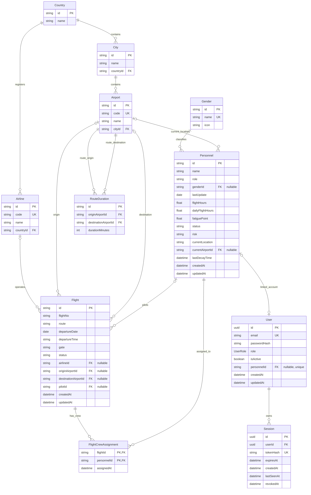

# SkyOps Database Entity-Relationship Diagram

This diagram documents the database models currently defined in `apps/api/prisma/schema.prisma`.

## Relationship notes

- **Country–City:** A country can contain multiple cities; each city belongs to one country.
- **Country–Airline:** A country can be associated with multiple airlines; each airline references one country.
- **City–Airport:** A city can contain multiple airports; each airport references one city.
- **Gender–Personnel:** A personnel record may optionally reference a gender record.
- **Airport–Personnel:** A personnel record may optionally reference its current airport.
- **Airline–Flight:** A flight may optionally reference an airline.
- **Airport–Flight:** A flight may optionally reference an origin airport and a destination airport. These are two separate relationships to `Airport`.
- **Personnel–Flight (pilot):** A flight may optionally reference a pilot. A personnel record can be referenced as pilot for multiple flights.
- **Flight–Personnel (crew):** This many-to-many relationship is represented by `FlightCrewAssignment`. Its composite primary key is `(flightId, personnelId)`; deleting a flight or personnel record cascades to its assignment rows.
- **Airport–RouteDuration:** Each route-duration record references an origin airport and a destination airport. The origin/destination pair is unique.
- **Personnel–User:** A user account may optionally be linked to one personnel record. `User.personnelId` is nullable and unique, so a personnel record can have at most one linked user account.
- **User–Session:** A user can have multiple sessions. Deleting a user cascades to its sessions.

## Enumerations and implementation details

- `UserRole`: `ADMIN`, `STAFF`, `PASSENGER`.
- `FlightCrewAssignment` uses a composite primary key rather than a separate ID.
- Nullable foreign keys are marked as optional in the diagram.
- `createdAt`, `updatedAt`, and session timestamps are managed by the application/Prisma schema as defined in the model.
- The diagram reflects the current Prisma schema. It does not imply that every domain workflow using these tables is already exposed through the v2 API.
